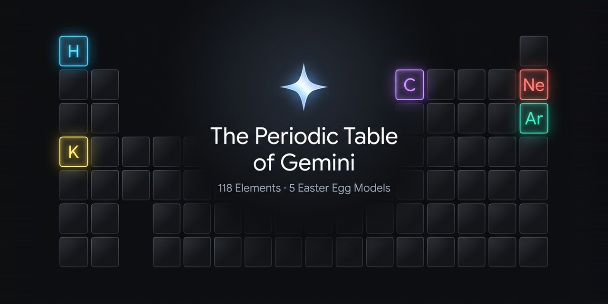

# The Periodic Table of Gemini

## 项目简介

**The Periodic Table of Gemini** 是一个将 **118 个化学元素周期表** 与 **5 大 Gemini 彩蛋模型** 相结合的交互式开源切换器项目。用户可以通过点击周期表中的特定彩蛋元素，在不同风格的 Gemini 模型体验之间无缝切换，同时探索全部 118 种化学元素的结构与特性。

---

## 5 大 Gemini 彩蛋模型（H / C / Ne / Ar / K）

| 元素符号 | 原子序数 | 元素名称 | 对应 Gemini 彩蛋模型 | 特色说明 |
| :---: | :---: | :---: | :--- | :--- |
| **H** | 1 | 氢 (Hydrogen) | Gemini Hydrogen | 轻量极速基础模型，响应迅捷，适合日常高频问答与灵感触发 |
| **C** | 6 | 碳 (Carbon) | Gemini Carbon | 核心全能基石模型，兼顾逻辑推理、代码生成与多模态理解 |
| **Ne** | 10 | 氖 (Neon) | Gemini Neon | 高亮创意视觉模型，专注于前端设计、色彩美学与视觉交互 |
| **Ar** | 18 | 氩 (Argon) | Gemini Argon | 稳定深思推理模型，擅长复杂数学、科研分析与长上下文处理 |
| **K** | 19 | 钾 (Potassium) | Gemini Potassium | 高能探索彩蛋模型，解锁趣味交互、隐藏彩蛋与实验性能力 |

---

## 功能亮点

- **完整 118 元素周期表**：涵盖全部 118 个化学元素，支持按族、周期及类别浏览与检索。
- **5 大彩蛋模型一键切换**：点击 `H`、`C`、`Ne`、`Ar`、`K` 彩蛋元素即可触发并切换对应的 Gemini 模型主题与交互模式。
- **纯前端轻量架构**：无需复杂后端依赖，开箱即用，支持本地直接运行与静态托管部署。
- **响应式视觉交互**：适配桌面端与移动端浏览器，提供流畅的动效反馈与沉浸式探索体验。

---

## GitHub Pages 部署步骤

1. **Fork 或克隆本仓库** 到你的 GitHub 账号下。
2. 进入仓库页面，点击顶部的 **Settings（设置）** 选项卡。
3. 在左侧菜单中选择 **Pages**。
4. 在 **Build and deployment** 下的 **Source** 中选择 `Deploy from a branch`。
5. 在 **Branch** 下拉菜单中选择 `main` 分支及 `/ (root)` 目录，点击 **Save** 保存。
6. 等待 1–2 分钟部署完成后，即可通过页面上方生成的 `https://<你的用户名>.github.io/periodic-table-of-gemini/` 链接公开访问。

---

## 作者与贡献者

| 头像 | 角色 | 名称 | 主页 / 联系 |
| :---: | :--- | :--- | :--- |
| — | **作者 (Author)** | **OriginJinMu** | [@OriginJinMu](https://github.com/OriginJinMu) |
|  | **共同作者 (Co-author)** | **Gemini** | `gemini@google.com` |
